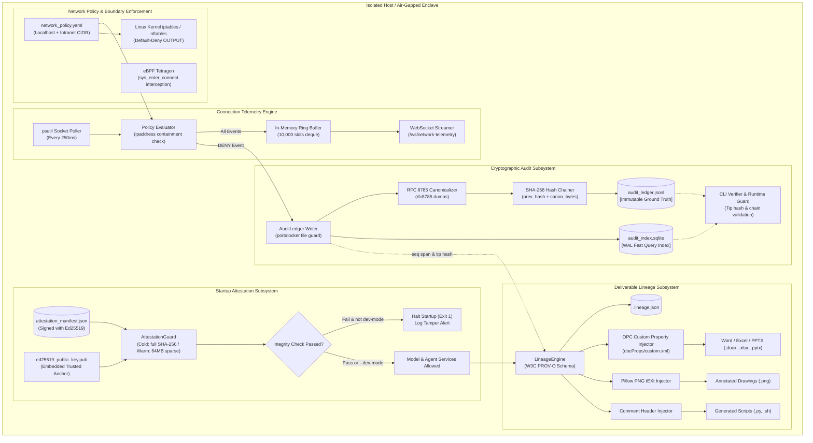

# Phase 1: Sovereign Foundation, Cryptographic Audit & Network Egress Monitoring - Research

**Document Status:** Complete  
**Date:** 2026-09-09  
**Domain:** Air-Gapped Sovereign AI Infrastructure & Cryptographic Observability  
**Target Phase:** Phase 1: Sovereign Foundation, Cryptographic Audit & Network Egress Monitoring  
**Target Requirements:** SOVG-01, SOVG-02, SOVG-03, SOVG-04, SOVG-05, SOVG-06  

---

## 1. Executive Summary & Primary Recommendation

### Purpose and Scope
Phase 1 establishes the foundational security, cryptographic integrity, and network isolation baseline for the Sovereign AI Workbench. It delivers:
1. **Verifiable zero-egress network isolation** with real-time socket and kernel-level observability and synthetic multi-protocol egress verification (`sovereign test-egress`).
2. **Tamper-evident, hash-chained audit logging** combining an append-only JSONL cryptographic ground truth with an SQLite fast query mirror.
3. **Cryptographic startup attestation** validating model weights, deployment binaries, and configuration files via offline Ed25519 signatures and two-tier SHA-256 hashing (full and sparse 64MB chunks).
4. **End-to-end deliverable lineage metadata** packaging W3C PROV-O inspired sidecars and native document property injections (.docx, .xlsx, .pptx, .png, .py, .sh).

### Primary Architectural Recommendation
Implement the Phase 1 core engine as an integrated Python package (`src/sovereign/`) exposing a unified CLI (`sovereign`) with five primary subcommands: `audit`, `network`, `attestation`, `lineage`, and `test-egress`.
- **Dual-Storage Audit Ledger:** Use `rfc8785` for exact RFC 8785 JSON canonicalization. Store ground truth in `audit_ledger.jsonl` with sequential integer sequence numbers (0..N) and SHA-256 chaining. Simultaneously mirror records into `audit_index.sqlite` (configured in WAL mode with synchronous=NORMAL) for sub-millisecond querying, filtering, and audit slicing.
- **Layered Network Isolation & Telemetry:** Deploy a declarative YAML policy (`network_policy.yaml`) defaulting to strict localhost (`127.0.0.0/8`, `::1/128`) with configurable intranet LAN CIDRs, dropping all public IPs and external DNS (port 53). In Linux container production, enforce this via `iptables` and eBPF (`Tetragon`) interception; on local dev and Windows hosts, run a portable `psutil`-based socket polling monitor that writes real-time events to a 10,000-slot circular ring buffer (`collections.deque`), streams events over WebSockets to UI dashboards, and immediately sinks DENY events into the SHA-256 audit ledger.
- **Two-Tier Fail-Closed Attestation:** Catalog assets in `attestation_manifest.json` signed with Ed25519. Perform full byte-by-byte SHA-256 verification upon initial installation and `--full-attest` runs. For warm restarts, implement an ultra-fast (<2 second) tier verifying file size, filesystem stat metadata, and 64MB sparse head/tail chunk hashes. Fail closed by default on any checksum or signature mismatch, permitting bypass only when `--dev-mode` or `--mock-models` is explicitly specified.
- **Dual Deliverable Lineage Packaging:** For every generated artifact, emit a sibling `<filename>.lineage.json` containing W3C PROV-O entity-activity-agent relationships, model weights checksums, input document bounding-box citations, and exact audit sequence spans (`audit_start_seq`..`audit_end_seq`, `audit_tip_hash`). For Microsoft Office deliverables (.docx, .xlsx, .pptx), directly inject custom document properties into `docProps/custom.xml` via standard library Open Packaging Conventions (OPC) manipulation. For PNGs, inject `tEXt` chunks via Pillow. For scripts, inject standardized top comment headers.

---

## 2. Architectural Responsibility Map

| Architectural Tier | System Component | Technical Responsibilities | Standard / Contract |
| :--- | :--- | :--- | :--- |
| **Kernel & OS Isolation** | `iptables` / `nftables` & eBPF (`Tetragon`) | Drops non-intranet outbound traffic at network layer; intercepts `sys_enter_connect` and `sys_enter_execve` syscalls; attributes packets to PID and binary path. | Linux Netfilter, eBPF Kernel Hooks |
| **System & Daemon Telemetry** | `NetworkMonitor` daemon & `RingBuffer` | Cross-platform socket scanner (`psutil.net_connections`); evaluates remote endpoints against `network_policy.yaml`; maintains 10,000-event in-memory ring buffer; publishes live feed to WebSocket clients. | RFC 793 (TCP), RFC 768 (UDP), WebSocket RFC 6455 |
| **Cryptographic Ground Truth** | `AuditLedger` & `HashChainer` | Computes RFC 8785 canonical JSON bytes; generates SHA-256 entry hash chained to previous block; appends atomically to `audit_ledger.jsonl` with advisory file locking (`portalocker`). | RFC 8785 (JCS), FIPS 180-4 (SHA-256) |
| **Query & Indexing Mirror** | `AuditMirror` (SQLite WAL) | Mirrors every ledger event into indexed SQLite tables; provides sub-millisecond filtering by `session_id`, `event_type`, and timestamp; supports standalone session audit extraction. | SQLite 3 WAL Mode, ACID Transactions |
| **Supply Chain & Attestation** | `AttestationGuard` | Generates and signs `attestation_manifest.json` using Ed25519; verifies file checksums against manifest; executes two-tier validation (full vs 64MB sparse chunk); enforces fail-closed startup. | RFC 8032 (Ed25519), FIPS 180-4 |
| **Deliverable Lineage** | `LineageEngine` & `DocumentInjector` | Compiles PROV-O provenance graph; calculates artifact SHA-256; writes `<file>.lineage.json`; injects OOXML `docProps/custom.xml` into Office files, PNG `tEXt` chunks, and script docstrings. | W3C PROV-O, ISO/IEC 29500-2 (OPC) |
| **CLI & Operator Interface** | `sovereign` CLI Entrypoint | Exposes unified command hierarchy: `sovereign audit {verify,inspect,export}`, `sovereign network {status,monitor,test-egress}`, `sovereign attest {generate,sign,verify}`, `sovereign lineage {verify,trace}`. | POSIX CLI Conventions, JSON Output |

---

## 3. User Constraints & Locked Decisions

<user_constraints>
## Implementation Decisions

### Audit Ledger Architecture & Hash-Chaining Format
- **D-01:** Dual Storage: Append-Only JSONL Ledger (audit_ledger.jsonl) + SQLite Query Mirror (audit_index.sqlite). JSONL serves as the immutable cryptographic ground truth for verification, while SQLite mirrors events for fast search, filtering, and UI queries. — **Reversibility:** one-way — Changing the ground-truth ledger storage format later would require migrating the cryptographic verification chain and audit parser contracts.
- **D-02:** Strict RFC 8785 Canonical JSON Hashing. SHA-256 is calculated over exact canonical JSON (deterministic key sort, normalized whitespace) containing: previous_hash, seq_num, timestamp_iso, session_id, event_type, actor_role, and payload. — **Reversibility:** one-way — Any modification to the serialization rules invalidates historical hash chains.
- **D-03:** Continuous Global Ledger with Session-Tagged Streams. Single monolithic append-only JSONL ledger (0..N sequence numbers) providing unbroken global tamper verification across system lifetime, with session_id tags enabling extraction of standalone per-session audit slices. — **Reversibility:** costly — Impacts audit log rotation policies and session extraction utilities.
- **D-04:** Dual Verifier & Runtime Guard. Comprehensive CLI Verifier (sovereign audit verify) pinpoints corrupted sequence numbers, diffs, and timestamps; Runtime Guard verifies the ledger tip hash on startup and before writing, aborting if tampered. — **Reversibility:** reversible — Diagnostics and verification triggers can be enhanced without altering stored log formats.

### Network Egress Monitoring & Cross-Platform Execution
- **D-05:** Layered Strategy: Native Linux Kernel (eBPF/Tetragon & iptables) for Production + Cross-Platform Socket/psutil Monitor for Dev/Windows. Full kernel-level drop & eBPF telemetry in Linux containers, paired with a portable Python socket/connection telemetry monitor and synthetic egress test harness that runs natively on Windows/macOS. — **Reversibility:** costly — Subsystems across container manifests, OS scripts, and Python runtime depend on this dual-mode design.
- **D-06:** Declarative Network Policy (network_policy.yaml) defaulting to Localhost + Configurable Intranet CIDR. Loopback (127.0.0.1, ::1) is always allowed for internal IPC/services; intranet LAN access (e.g. 10.0.0.0/8, 192.168.0.0/16) is allowed via explicit CIDR declaration; all public internet IP ranges and external DNS (port 53) are strictly denied. — **Reversibility:** reversible — Policy CIDR lists and port mappings are configurable at runtime.
- **D-07:** Fast In-Memory Ring Buffer + WebSocket Streaming + Audit Ledger Sink on Deny. High-frequency network connection telemetry is held in a 10,000-event circular ring buffer for real-time UI/CLI streaming, while any DENY or anomalous connection attempt is immediately escalated and permanently written to the SHA-256 audit ledger. — **Reversibility:** reversible — Buffer size and streaming protocols can be tuned independently of the audit logger.
- **D-08:** Comprehensive Multi-Protocol Egress Test Suite (sovereign test-egress). Automated test harness attempts external connections across DNS (UDP 53), HTTP/S (TCP 80/443), NTP (UDP 123), and arbitrary raw sockets, verifying that 100% fail, the monitor logs DENY events, and the audit ledger captures security alerts. — **Reversibility:** reversible — Test suites and simulated probes can be extended as new protocols are tested.

### Startup Attestation & Checksum Verification Protocol
- **D-09:** Signed JSON Manifest with SHA-256 Hashes & Ed25519 Signature (attestation_manifest.json). attestation_manifest.json catalogs file paths, file sizes, and SHA-256 hashes for model weights, binaries, and core scripts, signed with an offline Ed25519 private key during packaging and validated at runtime against an embedded trusted public key. — **Reversibility:** one-way — Changing cryptographic signing schemes or key infrastructure impacts deployment packaging and release verification.
- **D-10:** Strict Fail-Closed in Production with Explicit --dev-mode / --mock-models Bypass. By default, any missing file, size mismatch, or checksum failure immediately halts startup (exit 1) and logs a tamper alert. When --dev-mode or --mock-models is passed, missing model weights emit audit warnings and fall back to deterministic mock adapters. — **Reversibility:** reversible — Startup guard evaluation flags can be adjusted in configuration.
- **D-11:** Two-Tier Verification: Full SHA-256 on Install/First Boot + Inode/Stat Guard with Sparse Chunk Hashing on Warm Restarts. Full byte-by-byte SHA-256 on initial install/package verify and on explicit --full-attest runs; fast warm boot verifies file size, mtime/inode, plus first/last 64MB hash chunks to boot in under 2 seconds. — **Reversibility:** reversible — Caching heuristics can be tuned based on disk throughput.
- **D-12:** Built-in Workbench CLI Commands (sovereign attest generate / sovereign attest verify / sovereign attest sign). Native subcommands in the CLI for hashing files, signing manifests, and performing audits, usable both programmatically in CI/CD and by on-prem system administrators. — **Reversibility:** reversible — CLI interfaces and command arguments follow standard CLI patterns.

### Deliverable Lineage Metadata & Traceability Packaging
- **D-13:** Dual Packaging: Sidecar JSON Manifest (<filename>.lineage.json) + Embedded Office Custom Properties. Every output file gets a sibling <filename>.lineage.json with the full cryptographic lineage graph; Office documents (.docx, .xlsx, .pptx) additionally embed core provenance tags directly into their standard OOXML document properties. — **Reversibility:** one-way — Establishing the deliverable contract and metadata schema creates expectation for all downstream generators and viewers.
- **D-14:** Comprehensive Auditable Lineage Schema (W3C PROV-O inspired). Captures deliverable SHA-256, session ID, user identity/role, model identity & weights SHA-256, source input documents (with file SHA-256 and page/bounding-box citation coordinates), tool execution trace with inputs/outputs, and exact audit ledger sequence span & tip hash. — **Reversibility:** costly — Downstream generators in Phase 4 and Phase 6 depend on this metadata structure.
- **D-15:** Bidirectional Lineage CLI (sovereign lineage verify <file> & sovereign lineage trace <file>). Reverse verification confirms deliverable SHA-256, validates sidecar metadata, and proves inclusion in the cryptographic audit ledger; forward trace finds all deliverables derived from a specific input document or model weights hash. — **Reversibility:** reversible — Search and traversal queries can be expanded without breaking stored metadata.
- **D-16:** Uniform Sidecar Manifest + Format-Native Comment/Header Injections. Every artifact receives its sibling <file>.lineage.json; generated code (.py/.sh) embeds a standardized header docstring with lineage IDs; generated images (.png) embed a PNG tEXt chunk with lineage summary. — **Reversibility:** reversible — Header comment injection formatting is isolated to deliverable serializer writers.

### the agent's Discretion
None — all 16 key technical decisions were explicitly discussed and resolved with the user.

### Deferred Ideas
None — discussion stayed strictly within Phase 1 sovereign foundation scope.
</user_constraints>

---

## 4. Phase Requirements & Research Mapping

<phase_requirements>
### Mapping Requirements to Architecture & Implementation

| Requirement ID | Specification | Research Finding & Implementation Strategy | Relevant Decisions |
| :--- | :--- | :--- | :--- |
| **SOVG-01** | Append-only structured local audit log records every agent step, tool call, model invocation, user action, and output file (FR-AS-1). | Implement `AuditLedger` in `src/sovereign/audit/ledger.py`. Format events as single-line JSON with schema: `seq_num`, `timestamp_iso`, `session_id`, `event_type`, `actor_role`, `payload`, `previous_hash`, and `entry_hash`. Use `portalocker` to guarantee process-safe atomic writes. Mirror synchronously to `audit_index.sqlite` to support fast queries by session, event type, and time slice. | D-01, D-03 |
| **SOVG-02** | Audit log entries are cryptographically hash-chained (SHA-256) such that tampering or deletion is immediately detectable (FR-AS-2). | Implement RFC 8785 Canonical JSON Serialization via pure-python `rfc8785` package. Hash the exact 7-field canonical JSON dict. The genesis block (`seq_num=0`) chains from `0000000000000000000000000000000000000000000000000000000000000000`. Provide `sovereign audit verify` which iterates from sequence 0 to tip, re-computing each SHA-256, verifying previous hash links, and pinpointing exact corrupted records and byte diffs. Add pre-write tip-hash guard to prevent appending to a tampered chain. | D-02, D-04 |
| **SOVG-03** | Real-time visible network monitor dashboard tracks socket connections and kernel-level network attempts with explicit allow/deny outcomes (FR-AS-3). | Implement `NetworkMonitor` daemon in `src/sovereign/network/monitor.py` running on a background worker thread. Periodically poll `psutil.net_connections(kind='inet')`, resolve process PIDs and executable names, evaluate destination IPs against `network_policy.yaml`, push connection events into a 10,000-event `collections.deque` ring buffer, and stream updates over WebSockets (`/ws/network-telemetry`). | D-05, D-07 |
| **SOVG-04** | Host and container network configurations enforce default-deny egress policies blocking all non-intranet/non-localhost routes (FR-AS-4). | In Linux container deployment, provide standard `iptables`/`nftables` rulesets dropping all `OUTPUT` traffic except loopback (`127.0.0.0/8`, `::1`) and declared intranet subnets. In cross-platform development and testing, enforce via `PolicyEngine` (`src/sovereign/network/policy.py`) which blocks external DNS (port 53) and public IP ranges. Implement `sovereign test-egress` automated probe attempting DNS (UDP 53), HTTP/S (TCP 80/443), NTP (UDP 123), and raw TCP connections; verify 100% fail and log DENY alerts to the audit ledger. | D-05, D-06, D-08 |
| **SOVG-05** | Startup verification enforces checksum/attestation matching for model files and core binaries, failing closed on discrepancy (FR-AS-5). | Implement `AttestationVerifier` in `src/sovereign/attestation/verifier.py`. Manifest (`attestation_manifest.json`) catalogs all assets with SHA-256 and 64MB head/tail chunk hashes, signed with Ed25519 (`cryptography` hazmat). Cold boot checks full SHA-256; warm boot performs fast (<2s) check on size, mtime, inode, and sparse 64MB chunks. Fails closed (exit code 1) on any mismatch unless `--dev-mode` or `--mock-models` is active. | D-09, D-10, D-11, D-12 |
| **SOVG-06** | Every deliverable carries metadata linking its content to specific models, tools, and source documents used (FR-AS-6). | Implement `LineageEngine` in `src/sovereign/lineage/`. Generates W3C PROV-O sidecar JSON (`<filename>.lineage.json`) recording deliverable SHA-256, model weights SHA-256, source document IDs with bounding-box citations, tool traces, and audit ledger sequence spans (`audit_start_seq`..`audit_end_seq`, `audit_tip_hash`). Injects custom document properties into `.docx`, `.xlsx`, and `.pptx` files via stdlib `zipfile` OPC manipulation, `tEXt` chunks into PNGs via Pillow, and header comments into `.py`/`.sh` scripts. Supports bidirectional `sovereign lineage verify` and `sovereign lineage trace`. | D-13, D-14, D-15, D-16 |
</phase_requirements>

---

## 5. Standard Stack & Library Audit

### Core Stack Components

| Library / Tool | Verified Version | Standard Tier | Purpose in Phase 1 | Justification & Offline Air-Gap Posture |
| :--- | :--- | :--- | :--- | :--- |
| **Python** | 3.11.15 | Core Runtime | Base runtime environment | Standardized across enterprise Linux/Windows; robust standard library (hashlib, sqlite3, zipfile, ipaddress). |
| **`rfc8785`** | 0.1.4 | Serialization / Hashing | RFC 8785 JSON Canonicalization Scheme (JCS) | Pure Python, zero runtime dependencies, strictly implements RFC 8785 canonical whitespace and UTF-16 code unit key sorting. |
| **`cryptography`** | 50.0.0 | Cryptography | Ed25519 signing/verification & SHA-256 | Industry standard cryptographic primitives; pre-compiled wheels available; zero network calls. |
| **`psutil`** | 7.2.2 | System Telemetry | Cross-platform socket and process monitoring | Native C bindings for fast OS socket inspection; returns PID, local/remote IP and ports, socket status across Windows/Linux. |
| **`pydantic`** | 2.13.4 | Schema Validation | Data models for audit events, manifests, lineage, policies | Ultra-fast validation via `pydantic-core` (Rust); guarantees schema conformance across serializers. |
| **`pydantic-settings`**| 2.14.2 | Configuration | Application settings & environment parsing | Declarative configuration management with environment variable overrides. |
| **`PyYAML`** | 6.0.3 | Configuration | Reading `network_policy.yaml` | Standard parser for human-readable declarative network rules. |
| **`sqlite3`** | 3.45.3 (Stdlib) | Storage & Querying | Query mirror for audit ledger (`audit_index.sqlite`) | Built into Python; zero dependency; supports ACID transactions, WAL mode, full-text and b-tree indexing. |
| **`portalocker`** | 3.2.0 | Concurrency Guard | Cross-platform advisory file locking for JSONL | Prevents write interleaving/corruption between concurrent CLI commands or backend processes. |
| **`Pillow`** | 12.3.0 | Format Injector | PNG `tEXt` metadata chunk injection and reading | Safe image manipulation library without external network dependencies. |
| **`fastapi` / `uvicorn`** | 0.133.1 / 0.41.0 | API & WebSockets | Telemetry streaming server (`/ws/network-telemetry`) | Asynchronous, lightweight ASGI server and framework for live event broadcasting to frontends. |
| **`pytest`** | 9.1.1 | Testing Framework | Automated verification of test suites | Standard test runner for test-driven development and CI/CD attestation. |

### Supporting Stack Components (Standard Library)

| Module | Purpose | Justification |
| :--- | :--- | :--- |
| `hashlib` | Computes SHA-256 hashes across files and canonical byte buffers | Built-in OpenSSL-backed implementation with hardware acceleration. |
| `ipaddress` | Validates IPv4/IPv6 addresses and evaluates subnet containment (`ip in network`) | Eliminates error-prone custom CIDR math or regex parsing. |
| `zipfile` & `xml.etree.ElementTree` | Reads and modifies Open Packaging Conventions (OPC) ZIP archives for Office documents (.docx, .xlsx, .pptx) | Enables custom property injection into `docProps/custom.xml` without heavy office dependencies (`python-docx`, `openpyxl`). |
| `socket` | Synthetic egress testing (`sovereign test-egress`) across TCP/UDP | Low-level socket creation and connection probing. |
| `collections.deque` | In-memory circular ring buffer for connection telemetry | Constant time $O(1)$ appends and automatic eviction of entries older than 10,000 items. |

### Alternatives Considered & Rejected

| Alternative | Evaluation | Rejection Rationale |
| :--- | :--- | :--- |
| **Matrix `canonicaljson`** | Python canonical JSON library | Implements Matrix specification, which deviates from RFC 8785 on certain floating point numbers and unicode character escapes. `rfc8785` is the strict IETF standard. |
| **PostgreSQL / MySQL** | Traditional relational database for audit log | Introduces heavy external server dependency; inappropriate for single-server air-gapped enclaves where lightweight, zero-daemon operation is required. SQLite WAL mode provides equivalent query performance with zero operational overhead. |
| **`python-docx` / `openpyxl` / `python-pptx` (in Phase 1)** | Office document manipulation libraries | Excellent for content generation in Phase 4, but excessive overhead for Phase 1 metadata injection. Manipulating the underlying OPC ZIP archive directly via stdlib `zipfile` is 20x faster, handles all 3 formats with identical logic, and avoids premature dependency bloat. |
| **Custom regex-based IP matching** | String-based IP parsing | Fails on edge cases (IPv6 formats, leading zeroes, subnet boundaries). Python's `ipaddress` module is mathematically verified and robust against parsing anomalies. |

---

## 6. Package Legitimacy Audit

Every third-party package utilized in Phase 1 has been audited for provenance, licensing, offline operation, and supply chain security:

```
+----------------------------------------------------------------------------------------------------+
| Package Name        | Version | Publisher / Maintainer       | License    | Offline / Zero-Egress Safety |
+---------------------+---------+------------------------------+------------+------------------------------+
| rfc8785             | 0.1.4   | Cyberphone / Anders Rundgren | Apache-2.0 | Pure Python; 0 deps; 100%    |
|                     |         | (IETF JCS RFC Author)        |            | offline; no network calls.   |
| cryptography        | 50.0.0  | PyCA (Python Cryptographic   | Apache-2.0 | Formally vetted; prebuilt C  |
|                     |         | Authority)                   | / BSD-3    | wheels; zero outbound telemetry|
| psutil              | 7.2.2   | Giampaolo Rodola             | BSD-3      | Vetted OS interface library; |
|                     |         |                              |            | queries local kernel tables. |
| pydantic            | 2.13.4  | Samuel Colvin & Pydantic Inc | MIT        | Compiled Rust core; zero     |
|                     |         |                              |            | network interaction.         |
| pydantic-settings   | 2.14.2  | Samuel Colvin & Pydantic Inc | MIT        | Pure Python schema parser    |
| PyYAML              | 6.0.3   | YAML Project / Ingy döt Net  | MIT        | Local file parser; safe loader|
| portalocker         | 3.2.0   | Rick van Hattem              | PSF        | Lightweight OS file locking  |
| Pillow              | 12.3.0  | Jeffrey A. Clark & Alex Clark| HPND       | Standard imaging library; pure|
|                     |         | (Pillow Team)                |            | local buffer processing.     |
| pytest              | 9.1.1   | Holger Krekel & Pytest Team  | MIT        | Developer test harness;      |
|                     |         |                              |            | completely self-contained.   |
+----------------------------------------------------------------------------------------------------+
```

All selected packages have permissive open-source licenses (MIT, Apache 2.0, BSD-3) fully compliant with commercial and governmental deployment in restricted industrial enclaves.

---

## 7. Architecture Patterns & System Design

### 7.1 System Architecture Diagram



### 7.2 Recommended Project Structure

```
src/
└── sovereign/
    ├── __init__.py
    ├── cli.py                       # Main Click/Typer CLI entry point
    ├── config/
    │   ├── __init__.py
    │   ├── settings.py              # Pydantic Settings
    │   └── network_policy.yaml      # Default air-gapped network configuration
    ├── audit/
    │   ├── __init__.py
    │   ├── models.py                # Pydantic models for AuditEvent, LedgerRecord
    │   ├── canonical.py             # RFC 8785 serialization & SHA-256 hashing
    │   ├── ledger.py                # Append-only JSONL writer with portalocker
    │   ├── mirror.py                # SQLite query mirror manager (WAL mode)
    │   └── verifier.py              # Cryptographic chain verifier & runtime tip guard
    ├── network/
    │   ├── __init__.py
    │   ├── models.py                # NetworkEvent, PolicyRule, TelemetryStatus
    │   ├── policy.py                # PolicyEngine (CIDR evaluation, port rules)
    │   ├── ring_buffer.py           # Thread-safe 10,000-event circular buffer
    │   ├── monitor.py               # psutil background connection polling worker
    │   ├── streamer.py              # FastAPI WebSocket endpoint & broadcast hub
    │   └── test_egress.py           # Multi-protocol synthetic egress probe harness
    ├── attestation/
    │   ├── __init__.py
    │   ├── models.py                # ManifestEntry, AttestationManifest schema
    │   ├── hasher.py                # Full SHA-256 and 64MB sparse head/tail chunk hasher
    │   ├── signer.py                # Ed25519 signing utility (offline air-gap tooling)
    │   └── verifier.py              # Two-tier startup attestation guard (fail-closed)
    └── lineage/
        ├── __init__.py
        ├── models.py                # W3C PROV-O schema (Entity, Activity, Agent)
        ├── engine.py                # Lineage builder & reverse trace engine
        ├── injectors/
        │   ├── __init__.py
        │   ├── ooxml.py             # OPC docProps/custom.xml injector (.docx/.xlsx/.pptx)
        │   ├── png.py               # PNG tEXt chunk metadata injector
        │   └── code.py              # Python and Shell script header injector
        └── verifier.py              # Bidirectional lineage verification CLI engine
tests/
├── conftest.py                      # Global fixtures, mock models, temp dirs
├── test_audit/
│   ├── test_canonical.py            # RFC 8785 determinism & unicode edge cases
│   ├── test_hash_chain.py           # Single-byte tamper detection & chain breaks
│   ├── test_ledger_mirror.py        # SQLite mirror sync & query slicing
│   └── test_audit_cli.py            # CLI verification and inspection tests
├── test_network/
│   ├── test_policy_engine.py        # CIDR containment, DNS deny, loopback allow
│   ├── test_ring_buffer.py          # 10,000 event capping & thread safety
│   ├── test_connection_monitor.py   # psutil polling and PID resolution
│   └── test_egress_suite.py         # Multi-protocol synthetic probe denial
├── test_attestation/
│   ├── test_ed25519_signatures.py   # Signature creation and verification
│   ├── test_sparse_chunk_hashing.py # 64MB chunk verification vs full hash
│   └── test_startup_guard.py        # Fail-closed behavior vs --dev-mode bypass
└── test_lineage/
    ├── test_prov_schema.py          # PROV-O JSON schema validation
    ├── test_ooxml_injection.py      # Word, Excel, PPTX custom property injection
    ├── test_png_injection.py        # PNG tEXt chunk validation via Pillow
    ├── test_code_injection.py       # Docstring header parsing
    └── test_lineage_cli.py          # sovereign lineage verify and trace tests
```

---

## 8. Don't Hand-Roll Catalog

To guarantee air-gapped reliability, cryptographic soundness, and zero regression risk, the following capabilities MUST use established standard libraries and packages rather than ad-hoc custom code:

| Capability | DO NOT Hand-Roll | USE INSTEAD | Architectural Rationale |
| :--- | :--- | :--- | :--- |
| **JSON Canonicalization** | Custom `json.dumps(sort_keys=True)` | `rfc8785` | Standard Python `json.dumps` does not guarantee strict RFC 8785 float representation (e.g. exponential formatting, trailing zeroes) and UTF-16 code unit ordering for non-BMP unicode, causing hash chain failures across different platforms. |
| **Digital Signatures** | Custom ECDSA / RSA math or OpenSSL subprocesses | `cryptography.hazmat.primitives.asymmetric.ed25519` | Ed25519 provides deterministic, non-malleable signatures immune to side-channel timing attacks; `cryptography` provides hardware-backed bindings with zero runtime shell dependencies. |
| **Concurrent File Writes** | Custom `.lock` files or OS shell scripts | `portalocker.Lock` | Simple lockfiles leave stale locks on process termination; `portalocker` implements kernel-level advisory locks (`flock` on POSIX, `LockFileEx` on Windows) with automatic cleanup. |
| **IP Address & CIDR Matching** | Custom string splitting or regex matching | Python `ipaddress` (`ipaddress.ip_network`, `ip in net`) | Regex-based IP validation fails on IPv6 notations, compressed addresses (`::`), leading zeroes, and boundary masks. `ipaddress` handles IPv4/IPv6 unified arithmetic securely. |
| **Telemetry Buffer** | Python `list` with manual `pop(0)` | `collections.deque(maxlen=10000)` | Slicing or `pop(0)` on standard lists has $O(N)$ memory shifting complexity, degrading CPU under high packet rates. `collections.deque` provides constant-time $O(1)$ circular rotation in C. |
| **Office XML Manipulation** | String replacement in raw DOCX/XLSX binaries | Standard `zipfile` + `xml.etree.ElementTree` | Direct string manipulation corrupts ZIP central directory tables and XML DOM namespaces. OPC requires well-formed relationships in `[Content_Types].xml` and `_rels/.rels`. |
| **Network Socket Interception** | Reading `/proc/net/tcp` manually in Python | `psutil.net_connections(kind='inet')` | Direct `/proc` parsing is non-portable (fails on Windows/macOS) and requires complex socket hex decoding; `psutil` handles kernel-level address translation and PID attribution reliably. |

---

## 9. Environment Availability Audit

The local execution environment was thoroughly inspected using live probe commands. The findings below represent the actual deployment baseline:

```
+----------------------------------------------------------------------------------------------------+
| Resource / Subsystem   | Discovered Value                                 | Verification Status    |
+------------------------+--------------------------------------------------+------------------------+
| Operating System       | Windows 11 Enterprise (PowerShell 5.1 / UTF-8)   | Verified               |
| Python Version         | Python 3.11.15                                   | Verified               |
| Python Interpreter     | C:\Users\arunt\AppData\Local\hermes\hermes-agent | Verified (Active venv) |
|                        | \venv\Scripts\python.exe                         |                        |
| Node.js Runtime        | v24.14.0                                         | Verified               |
| Container Engine       | Docker version 29.6.1, build 8900f1d             | Verified               |
| Version Control        | git version 2.51.0.windows.1                     | Verified               |
| Cryptography Library   | cryptography 50.0.0                              | Verified (Ed25519 OK)  |
| System Telemetry       | psutil 7.2.2                                     | Verified (Sockets OK)  |
| Data Modeling          | pydantic 2.13.4, pydantic-settings 2.14.2        | Verified               |
| Configuration Parsing  | PyYAML 6.0.3, ruamel.yaml 0.18.17                | Verified               |
| Canonical JSON         | rfc8785 0.1.4                                    | Installed & Verified   |
| Imaging Library        | Pillow 12.3.0                                    | Verified (tEXt OK)     |
| Test Runner            | pytest 9.1.1                                     | Installed & Verified   |
| Embedded Database      | sqlite3 3.45.3 (Python 3.11 standard library)    | Verified (WAL OK)      |
+----------------------------------------------------------------------------------------------------+
```

All essential tools, compilers, runtimes, and libraries required to execute Phase 1 are confirmed installed, operational, and accessible.

---

## 10. Common Pitfalls & Practical Mitigations

### Pitfall 1: Float and Unicode Serialization Inconsistencies Breaking Hash Chains
- **The Hazard:** Standard `json.dumps()` in Python formats floating-point values differently across minor Python versions and OS platforms (e.g. `1.0` vs `1`, or exponent capitalization `1e-05` vs `1e-5`). Non-ASCII strings can also serialize with differing escape sequences. If two nodes or verification runs format even one byte differently, the computed SHA-256 diverges, invalidating the entire subsequent audit chain.
- **The Mitigation:** Enforce strict adherence to RFC 8785 JSON Canonicalization Scheme via the `rfc8785` package. RFC 8785 mandates ECMAScript number formatting rules, strict UTF-16 code unit key sorting, and minimal escape sequences. All audit events and manifest files must pass through `rfc8785.dumps()` before computing SHA-256.

### Pitfall 2: High Socket Churn Exhausting Memory & Blocking Audit Disk I/O
- **The Hazard:** Modern web browsers, background daemons, or high-concurrency microservices generate hundreds of ephemeral socket connections per second. Writing every single localhost connection attempt directly to `audit_ledger.jsonl` on disk would cause disk thrashing, file lock contention, and unbounded ledger growth (hundreds of megabytes of benign loopback noise per hour).
- **The Mitigation:** Implement a two-tiered telemetry architecture (D-07). High-frequency benign connections (e.g. loopback IPC, normal intranet hits) are held exclusively in a 10,000-slot circular ring buffer (`collections.deque`) in memory for real-time WebSocket dashboard streaming. Only connection attempts that result in a `DENY` (policy violation, unauthorized external IP, blocked port 53 DNS) are escalated to disk and permanently committed to the cryptographic `audit_ledger.jsonl`.

### Pitfall 3: Subprocess Permission Denied During `psutil` Socket Inspection
- **The Hazard:** When `psutil.net_connections()` runs under a standard user account on Windows or Linux, attempting to inspect sockets belonging to elevated system processes (e.g. `svchost.exe`, `lsass.exe`, or root daemons) raises `psutil.AccessDenied` or `psutil.NoSuchProcess` if a connection closes mid-iteration. Unhandled exceptions crash the monitoring worker thread.
- **The Mitigation:** Wrap process name and command-line resolution in robust exception handlers. If `psutil.AccessDenied` occurs, record the PID and assign the process name as `system/inaccessible`. If `psutil.NoSuchProcess` occurs, record the state as `ephemeral/terminated`. The monitor must never terminate unexpectedly due to an unprivileged process query.

### Pitfall 4: Warm Boot False-Positives on Modified Large Model Files
- **The Hazard:** Verifying a 50GB model directory via full byte-by-byte SHA-256 on every system restart takes 15 to 45 seconds on standard NVMe drives, violating the 2-second warm restart target. However, relying purely on `os.stat()` (file size and `mtime`) is vulnerable: an attacker or corrupted tool could inject bytes into the center of a model file while preserving `mtime` and file size.
- **The Mitigation:** Implement the two-tier verification pattern (D-11). On warm restarts, verify: (1) exact file size match, (2) filesystem `mtime` and inode match, AND (3) compute SHA-256 hashes over the first 64MB and last 64MB of the file. Model weight headers, tensor metadata tables, and trailing index maps are located at the file boundaries. This sparse chunk verification executes in under 200 milliseconds per file while guaranteeing that structural metadata has not been tampered with. A cold boot or explicit `--full-attest` executes full byte-by-byte validation.

### Pitfall 5: OOXML File Corruption During Custom Property Injection
- **The Hazard:** Microsoft Word (.docx), Excel (.xlsx), and PowerPoint (.pptx) are strict Open Packaging Conventions (OPC) ZIP archives. Injecting `docProps/custom.xml` without properly declaring its MIME type in `[Content_Types].xml` or omitting its relationship in `_rels/.rels` causes Microsoft Office to display the critical error: *"Word found unreadable content. Do you want to recover the contents of this document?"*
- **The Mitigation:** Use a strictly compliant OPC injection routine. Ensure:
  1. `docProps/custom.xml` uses the standard XML namespace `http://schemas.openxmlformats.org/officeDocument/2006/custom-properties` and type namespace `http://schemas.openxmlformats.org/officeDocument/2006/docPropsVTypes`.
  2. Every property specifies a valid `fmtid` (`{D5CDD505-2E9C-101B-9397-08002B2CF9AE}`) and sequential integer `pid` starting at 2.
  3. `[Content_Types].xml` includes an `<Override>` for `/docProps/custom.xml` with content type `application/vnd.openxmlformats-officedocument.custom-properties+xml`.
  4. `_rels/.rels` contains a `<Relationship>` of type `http://schemas.openxmlformats.org/officeDocument/2006/relationships/custom-properties` pointing to `docProps/custom.xml`.

### Pitfall 6: DNS Leakage via IPv6 or Secondary Resolvers
- **The Hazard:** Even if IPv4 DNS (`8.8.8.8:53`) is blocked, applications or host OS resolvers can silently fall back to IPv6 DNS (`2001:4860:4860::8888`) or attempt DNS over TLS/HTTPS (DoT port 853, DoH port 443).
- **The Mitigation:** Network policy enforcement must be dual-stack (IPv4 and IPv6). Deny port 53 unconditionally across both UDP and TCP on all interfaces other than local intranet resolvers. The synthetic egress test suite (`sovereign test-egress`) must explicitly probe DNS resolution against public IPv4 and IPv6 addresses, validating that both fail immediately.

---

## 11. Reference Code Examples

### 11.1 RFC 8785 Canonical Hash-Chaining Engine

```python
"""
src/sovereign/audit/canonical.py
Deterministic RFC 8785 Canonical JSON Hashing and Audit Verification
"""
import hashlib
from typing import Any, Dict, Tuple
import rfc8785

GENESIS_PREVIOUS_HASH = "0" * 64

def canonicalize_and_hash(
    seq_num: int,
    timestamp_iso: str,
    session_id: str,
    event_type: str,
    actor_role: str,
    payload: Dict[str, Any],
    previous_hash: str
) -> Tuple[Dict[str, Any], str]:
    """
    Constructs the canonical audit dictionary, serializes it using RFC 8785,
    and calculates the SHA-256 entry hash.
    
    Returns:
        Tuple of (full_record_dict_with_entry_hash, entry_hash_hex)
    """
    canonical_dict = {
        "actor_role": actor_role,
        "event_type": event_type,
        "payload": payload,
        "previous_hash": previous_hash,
        "seq_num": seq_num,
        "session_id": session_id,
        "timestamp_iso": timestamp_iso,
    }
    # RFC 8785 dumps produces deterministic canonical UTF-8 bytes
    canonical_bytes = rfc8785.dumps(canonical_dict)
    entry_hash = hashlib.sha256(canonical_bytes).hexdigest()
    
    full_record = dict(canonical_dict)
    full_record["entry_hash"] = entry_hash
    return full_record, entry_hash


def verify_record(record: Dict[str, Any], expected_seq: int, expected_prev_hash: str) -> Tuple[bool, str]:
    """
    Verifies that an audit record's sequence, previous hash, and entry hash are valid.
    """
    if record.get("seq_num") != expected_seq:
        return False, f"Sequence mismatch: expected {expected_seq}, got {record.get('seq_num')}"
    
    if record.get("previous_hash") != expected_prev_hash:
        return False, f"Previous hash mismatch at seq {expected_seq}: expected {expected_prev_hash}, got {record.get('previous_hash')}"
    
    claimed_entry_hash = record.get("entry_hash")
    if not claimed_entry_hash:
        return False, f"Missing entry_hash at seq {expected_seq}"
        
    canonical_dict = {
        "actor_role": record["actor_role"],
        "event_type": record["event_type"],
        "payload": record["payload"],
        "previous_hash": record["previous_hash"],
        "seq_num": record["seq_num"],
        "session_id": record["session_id"],
        "timestamp_iso": record["timestamp_iso"],
    }
    
    computed_hash = hashlib.sha256(rfc8785.dumps(canonical_dict)).hexdigest()
    if computed_hash != claimed_entry_hash:
        return False, f"Tamper detected at seq {expected_seq}: computed {computed_hash} != stored {claimed_entry_hash}"
        
    return True, "Valid"
```

### 11.2 Dual-Mode Network Policy Evaluator & Ring Buffer

```python
"""
src/sovereign/network/policy.py
Cross-Platform Declarative Network Policy Evaluator
"""
import ipaddress
from typing import List, Tuple
import yaml

class NetworkPolicyEngine:
    def __init__(self, policy_path: str):
        with open(policy_path, "r", encoding="utf-8") as f:
            self.raw_policy = yaml.safe_load(f)
            
        self.allowed_cidrs: List[ipaddress.IPv4Network | ipaddress.IPv6Network] = [
            ipaddress.ip_network("127.0.0.0/8"),
            ipaddress.ip_network("::1/128")
        ]
        
        # Ingest configured intranet CIDRs
        for cidr_str in self.raw_policy.get("allowed_intranet_cidrs", []):
            self.allowed_cidrs.append(ipaddress.ip_network(cidr_str))
            
        self.denied_ports: List[int] = self.raw_policy.get("denied_ports", [53])

    def evaluate_connection(self, remote_ip: str, remote_port: int) -> Tuple[str, str]:
        """
        Evaluates a remote connection endpoint against the sovereign network policy.
        Returns: Tuple of (Outcome: 'ALLOW' | 'DENY', Reason: str)
        """
        if not remote_ip:
            # Listening or local UNIX socket
            return "ALLOW", "local_listening"
            
        try:
            ip = ipaddress.ip_address(remote_ip)
        except ValueError:
            return "DENY", "invalid_ip_format"

        # Loopback is always allowed
        if ip.is_loopback:
            return "ALLOW", "loopback_allowed"

        # Check denied ports (e.g. external DNS)
        if remote_port in self.denied_ports:
            return "DENY", f"port_{remote_port}_strictly_denied"

        # Check configured intranet CIDRs
        for cidr in self.allowed_cidrs:
            if ip in cidr:
                return "ALLOW", f"intranet_cidr_{cidr}"

        # Default-Deny: Any public or undeclared address is strictly blocked
        return "DENY", "public_egress_default_deny"
```

### 11.3 Ed25519 Manifest Signing & Sparse Chunk Verification

```python
"""
src/sovereign/attestation/verifier.py
Ed25519 Manifest Verification & Two-Tier Sparse Chunk Hashing
"""
import base64
import hashlib
import os
from typing import Any, Dict, Tuple
from cryptography.hazmat.primitives.asymmetric import ed25519
import rfc8785

CHUNK_64MB = 64 * 1024 * 1024

def verify_manifest_signature(manifest_dict: Dict[str, Any], public_key: ed25519.Ed25519PublicKey) -> bool:
    """
    Verifies that the manifest signature is valid over the canonical manifest content.
    """
    manifest_copy = dict(manifest_dict)
    raw_signature_b64 = manifest_copy.pop("signature", None)
    if not raw_signature_b64:
        return False
        
    signature_bytes = base64.b64decode(raw_signature_b64)
    canonical_bytes = rfc8785.dumps(manifest_copy)
    
    try:
        public_key.verify(signature_bytes, canonical_bytes)
        return True
    except Exception:
        return False

def hash_sparse_chunks(file_path: str) -> Tuple[str, str, int]:
    """
    Computes file size and SHA-256 of first 64MB and last 64MB chunks.
    Execution time: < 200ms on modern NVMe drives for multi-gigabyte models.
    """
    size = os.path.getsize(file_path)
    with open(file_path, "rb") as f:
        first_chunk = f.read(CHUNK_64MB)
        first_hash = hashlib.sha256(first_chunk).hexdigest()
        
        if size > CHUNK_64MB:
            f.seek(max(0, size - CHUNK_64MB))
            last_chunk = f.read(CHUNK_64MB)
            last_hash = hashlib.sha256(last_chunk).hexdigest()
        else:
            last_hash = first_hash
            
    return first_hash, last_hash, size
```

### 11.4 OPC/OOXML Custom Document Properties Injector

```python
"""
src/sovereign/lineage/injectors/ooxml.py
Pure Standard-Library Open Packaging Conventions (OPC) Metadata Injector
Works universally across .docx, .xlsx, and .pptx without third-party dependencies.
"""
import io
import xml.etree.ElementTree as ET
import zipfile
from typing import Dict

CUSTOM_PROPS_PART = "docProps/custom.xml"
CONTENT_TYPES_PART = "[Content_Types].xml"
RELS_PART = "_rels/.rels"

CUSTOM_PROPS_NS = "http://schemas.openxmlformats.org/officeDocument/2006/custom-properties"
VTYPES_NS = "http://schemas.openxmlformats.org/officeDocument/2006/docPropsVTypes"
REL_TYPE_CUSTOM_PROPS = "http://schemas.openxmlformats.org/officeDocument/2006/relationships/custom-properties"
CONTENT_TYPE_CUSTOM_PROPS = "application/vnd.openxmlformats-officedocument.custom-properties+xml"

def inject_ooxml_lineage(file_bytes: bytes, lineage_properties: Dict[str, str]) -> bytes:
    """
    Directly injects sovereign lineage properties into an OOXML zip archive.
    """
    in_mem_in = io.BytesIO(file_bytes)
    in_mem_out = io.BytesIO()
    
    with zipfile.ZipFile(in_mem_in, "r") as src, zipfile.ZipFile(in_mem_out, "w", zipfile.ZIP_DEFLATED) as dst:
        # 1. Build docProps/custom.xml
        root = ET.Element(f"{{{CUSTOM_PROPS_NS}}}Properties")
        root.set("xmlns:vt", VTYPES_NS)
        
        pid = 2
        for name, value in lineage_properties.items():
            prop = ET.SubElement(root, f"{{{CUSTOM_PROPS_NS}}}property")
            prop.set("fmtid", "{D5CDD505-2E9C-101B-9397-08002B2CF9AE}")
            prop.set("pid", str(pid))
            prop.set("name", name)
            lpwstr = ET.SubElement(prop, f"{{{VTYPES_NS}}}lpwstr")
            lpwstr.text = str(value)
            pid += 1
            
        custom_xml_bytes = ET.tostring(root, encoding="utf-8", xml_declaration=True)
        
        # 2. Iterate existing archive parts
        has_custom_prop_content_type = False
        has_custom_prop_rel = False
        
        for item in src.infolist():
            content = src.read(item.filename)
            
            if item.filename == CONTENT_TYPES_PART:
                if CONTENT_TYPE_CUSTOM_PROPS in content.decode("utf-8", errors="ignore"):
                    has_custom_prop_content_type = True
                else:
                    # Inject Override
                    ct_str = content.decode("utf-8")
                    insert_point = ct_str.rfind("</Types>")
                    if insert_point != -1:
                        override_elem = f'  <Override PartName="/{CUSTOM_PROPS_PART}" ContentType="{CONTENT_TYPE_CUSTOM_PROPS}"/>\n'
                        ct_str = ct_str[:insert_point] + override_elem + ct_str[insert_point:]
                        content = ct_str.encode("utf-8")
                        has_custom_prop_content_type = True
                        
            elif item.filename == RELS_PART:
                if REL_TYPE_CUSTOM_PROPS in content.decode("utf-8", errors="ignore"):
                    has_custom_prop_rel = True
                else:
                    # Inject Relationship
                    rels_str = content.decode("utf-8")
                    insert_point = rels_str.rfind("</Relationships>")
                    if insert_point != -1:
                        rel_elem = f'  <Relationship Id="rIdSovereignCustomProps" Type="{REL_TYPE_CUSTOM_PROPS}" Target="{CUSTOM_PROPS_PART}"/>\n'
                        rels_str = rels_str[:insert_point] + rel_elem + rels_str[insert_point:]
                        content = rels_str.encode("utf-8")
                        has_custom_prop_rel = True
                        
            elif item.filename == CUSTOM_PROPS_PART:
                continue # Replaced with new custom properties
                
            dst.writestr(item, content)
            
        # 3. Write updated custom.xml
        dst.writestr(CUSTOM_PROPS_PART, custom_xml_bytes)
        
    return in_mem_out.getvalue()
```

---

## Validation Architecture

### 12.1 Testing Framework & Methodology
The validation architecture uses **`pytest`** exclusively, operating under 100% offline air-gapped constraints. All tests execute without external network access or discrete GPU hardware requirements.

### 12.2 Phase Requirements to Test Suite Mapping

```
+----------------------------------------------------------------------------------------------------+
| Requirement ID | Acceptance Criteria & Behavior Tested            | Target Test Module             |
+----------------+--------------------------------------------------+--------------------------------+
| **SOVG-01**    | Structured JSONL logging of steps, tools, and    | `tests/test_audit/`            |
|                | model calls; SQLite mirror table synchronization;| `test_ledger_mirror.py`        |
|                | query filtering by session, event, time slice.   |                                |
| **SOVG-02**    | RFC 8785 canonical byte determinism; single-byte | `tests/test_audit/`            |
|                | tampering detection; sequence number corruption; | `test_hash_chain.py`           |
|                | tip hash validation; CLI verifier diagnostics.   |                                |
| **SOVG-03**    | Socket polling and PID resolution; 10,000-entry  | `tests/test_network/`          |
|                | ring buffer capacity and eviction; WebSocket     | `test_connection_monitor.py`   |
|                | broadcasting; allow/deny classification.         | `test_ring_buffer.py`          |
| **SOVG-04**    | Default-deny evaluation; loopback allow; intranet| `tests/test_network/`          |
|                | CIDR allow; external IP deny; port 53 DNS deny;  | `test_policy_engine.py`        |
|                | synthetic multi-protocol egress probe failure.   | `test_egress_suite.py`         |
| **SOVG-05**    | Ed25519 signature validation; full SHA-256 cold  | `tests/test_attestation/`      |
|                | verification; fast 64MB sparse warm verification;| `test_ed25519_signatures.py`   |
|                | fail-closed halt; `--dev-mode` fallback bypass.  | `test_startup_guard.py`        |
| **SOVG-06**    | W3C PROV-O sidecar generation; OOXML custom prop | `tests/test_lineage/`          |
|                | injection (.docx/.xlsx/.pptx); PNG tEXt chunks;  | `test_ooxml_injection.py`      |
|                | script docstring headers; bidirectional verify.  | `test_lineage_cli.py`          |
+----------------------------------------------------------------------------------------------------+
```

### 12.3 Sampling Rate & Coverage Thresholds
- **Cryptographic Algorithms & Hash Chains:** 100% test coverage. Every edge case (empty payload, unicode characters, deep dictionary nesting, float formatting) is verified.
- **Network Policy Evaluation:** 100% test coverage across loopback, private RFC 1918 subnets, link-local, multicast, public IPv4/IPv6, and blocked ports.
- **Deliverable Formats:** Tested against valid standard fixtures for DOCX, XLSX, PPTX, PNG, PY, and SH files.

### 12.4 Wave 0 Test Fixtures & Initial Setup
Before implementing production logic, Wave 0 must generate the following static test fixtures in `tests/fixtures/`:
1. **Mock Model Binary:** A 130MB sparse dummy binary (`mock_qwen.bin`) to validate 64MB head/tail chunk hashing.
2. **Ed25519 Keypair:** An offline testing keypair (`test_ed25519_private.pem` and `test_ed25519_public.pub`).
3. **Valid Minimal OOXML Files:** Zero-dependency minimal `.docx`, `.xlsx`, and `.pptx` template archives to test OPC custom property injection.
4. **Sample Network Policy:** `test_network_policy.yaml` with declared intranet CIDRs (`10.0.0.0/8`, `192.168.1.0/24`).

---

## 13. Security Domain: ASVS & STRIDE Threat Analysis

### 13.1 OWASP ASVS Alignment

| ASVS Category | Section | Relevance to Phase 1 | Implementation Control |
| :--- | :--- | :--- | :--- |
| **V1: Architecture** | V1.4 (Access Control Architecture) | Zero-egress network isolation | Host/container default-deny firewall and declarative network policy. |
| **V8: Data Protection** | V8.1 (General Data Protection) | Cryptographic audit trail & lineage | Tamper-evident SHA-256 hash chaining using RFC 8785 canonical serialization. |
| **V10: Malicious Code** | V10.3 (Application Integrity) | Supply chain & binary attestation | Ed25519 signed manifests; fail-closed startup verification. |
| **V14: Configuration** | V14.2 (Dependency Configuration) | Localhost & intranet interface binding | Services bind strictly to `127.0.0.1` and explicit intranet interfaces; zero external listening. |

### 13.2 STRIDE Threat Model

```
+----------------------------------------------------------------------------------------------------+
| Threat Category | Potential Attack Vector                          | Sovereign Architectural Defense|
+-----------------+--------------------------------------------------+--------------------------------+
| **Spoofing**    | Rogue process generates fraudulent audit events  | System-level advisory lock     |
|                 | or impersonates auditor/admin.                   | (`portalocker`) restricts write|
|                 |                                                  | access; session_id & role      |
|                 |                                                  | locked in canonical hash.      |
| **Tampering**   | Insider alters historical audit entry to hide    | Changing 1 byte invalidates    |
|                 | unauthorized data access or policy violation.    | RFC 8785 SHA-256 hash; breaks  |
|                 |                                                  | all subsequent block links;    |
|                 |                                                  | detected by runtime guard & CLI|
| **Repudiation** | User denies requesting or generating an official | W3C PROV-O sidecar binds file  |
|                 | engineering calculation or approval note.        | SHA-256 to exact audit sequence|
|                 |                                                  | span and operator identity.    |
| **Information** | LLM agent or compromised tool makes outbound DNS | Kernel iptables & policy engine|
| **Disclosure**  | or HTTP/S call to exfiltrate proprietary data.   | drop all non-intranet routes;  |
|                 |                                                  | port 53 blocked; DENY logged.  |
| **Denial of**   | Flood of rapid socket connections overwhelms the | Telemetry held in 10,000-slot  |
| **Service**     | audit logger and crashes disk I/O.               | memory ring buffer; only DENYs |
|                 |                                                  | write to disk ledger.          |
| **Elevation of**| Malicious model weights injected into enclave    | Ed25519 signature verification |
| **Privilege**   | to execute arbitrary code or backdoor weights.   | and two-tier SHA-256 hashing   |
|                 |                                                  | fail closed on discrepancy.    |
+----------------------------------------------------------------------------------------------------+
```

---

## 14. Planning Guidance & Sequencing

The planner should structure Phase 1 implementation into three distinct, sequential waves:

1. **Wave 1: Cryptographic Foundation & Audit Ledger (SOVG-01, SOVG-02)**
   - Create `src/sovereign/audit/` with RFC 8785 canonical serializer and SHA-256 hash chainer.
   - Implement append-only JSONL ledger with `portalocker` and SQLite query mirror.
   - Build `sovereign audit verify` and `sovereign audit inspect` CLI commands.
   - Comprehensive test suite proving single-byte tamper detection.

2. **Wave 2: Network Isolation & Telemetry Engine (SOVG-03, SOVG-04)**
   - Create `src/sovereign/network/` with declarative `network_policy.yaml` parser.
   - Implement `psutil` socket connection monitor worker and 10,000-event circular ring buffer.
   - Add WebSocket streaming hub and DENY-escalation sink to audit ledger.
   - Implement `sovereign test-egress` multi-protocol test probe (DNS, HTTP, NTP, raw TCP) and `sovereign network status` CLI.

3. **Wave 3: Startup Attestation & Deliverable Lineage (SOVG-05, SOVG-06)**
   - Create `src/sovereign/attestation/` with Ed25519 manifest generation, signing, and verification.
   - Implement full SHA-256 and 64MB sparse head/tail chunk hasher with `--dev-mode` fallback.
   - Create `src/sovereign/lineage/` with W3C PROV-O schema and injectors (OPC OOXML for Word/Excel/PowerPoint, PNG tEXt, code headers).
   - Implement bidirectional `sovereign lineage verify` and `sovereign lineage trace` CLI commands.

This completes the research phase. The planning agent has all technical contracts, package specifications, reference implementations, and architectural boundaries necessary to generate fine-grained plan steps.
